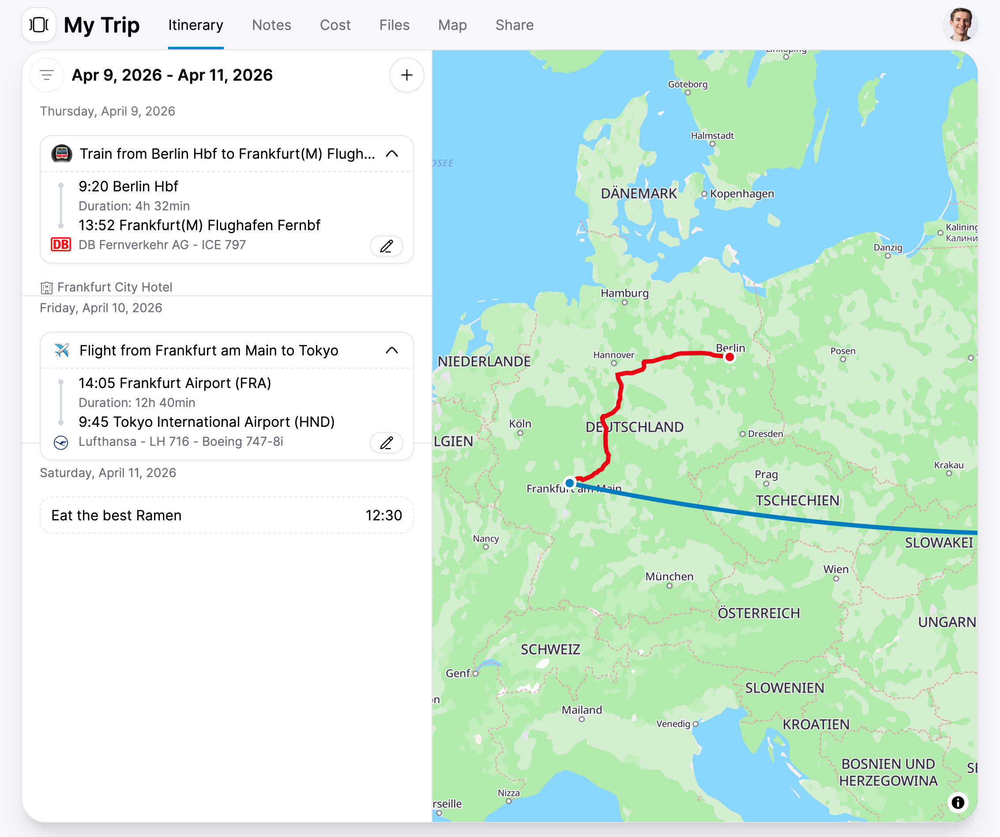

# kompass

*A local-first, encrypted travel planner with collaborative features*

## Features

- **Local-first & End-to-end encrypted** - Your data stays on your device, encrypted from end to end
- **Real-time collaboration** - Plan trips together with friends and family
- **Smart flight & train tracking** - Add transportation by flight/train number and get automatic updates
- **Push notifications** - Stay informed about schedule changes
- **Progressive Web App** - Install on any device, works offline
- **Free and open source** - No subscriptions, no lock-in

## Tech Stack

- **app/** - React-based Progressive Web App
  - Built with: React, Vite, TailwindCSS, Tanstack Router, MapLibre GL
- **transportation-api/** - Go service for flight/train data
  - Built with: Go, Fiber framework
- **server-worker/** - Effect TS background worker for schedule monitoring
  - Built with: Bun, Effect, web-push
- **sync-server/** - Dockerized Jazz sync server for real-time collaboration
  - Built with: Jazz

## Flight data configuration

Flight lookups use [AeroDataBox on RapidAPI](https://rapidapi.com/aedbx-aedbx/api/aerodatabox).
Subscribe to AeroDataBox there and copy the `X-RapidAPI-Key` value from its
API playground into `AERODATABOX_APIKEY` on the transportation-api service.
The optional `AERODATABOX_URL` defaults to `https://aerodatabox.p.rapidapi.com`.
Requests send `X-RapidAPI-Key` and `X-RapidAPI-Host` headers.
Amadeus credentials are no longer used.

A lookup without an origin groups through-flight legs from the route's initial
departure date, following connecting airports and scheduled times. It can make
additional API calls for onward departure dates, with a maximum 24-hour stopover
and eight legs. The selection dialog submits the chosen leg's own departure
date and origin; explicit-origin lookups use that local departure date.
The app and worker derive this date from `departureDateTime`; no separate
lookup date is stored. Legacy `amadeusFlightDate` values are ignored because
they can refer to the first leg of a through flight.
The API retains `amadeusFlightDate` as a compatibility alias for older clients.

Deploy the updated transportation-api, app, and server-worker together.
Confirm that the chosen subscription covers the required dates and usage,
including background schedule checks.

The `aerodatabox_lh717.json` and `aerodatabox_ek412.json` WireMock fixtures
are full RapidAPI responses captured on November 6, 2026 for departures on
that date (`dateLocalRole=Departure`), preserved except for JSON formatting.
The EK412 response includes both SYD–CHC and DXB–SYD legs departing on that
local date. The `aerodatabox_lh717_updated.json` fixture is a synthetic
schedule-change variant of the captured LH717 response: departure is moved
to 12:40, arrival to 19:15, and the aircraft model to Boeing 747-400.
These fixtures retain the provider's space-separated timestamps and minute
precision, alongside revised/live times that the schedule mapper ignores.

The `aerodatabox_ek412_onward.json` fixture is synthetic: the captured SYD–CHC
record shifted forward one day to test the November 7 continuation. Its times
have not been independently verified with a November 7 API capture. The
November 6 capture remains unchanged, including its earlier SYD departure.
